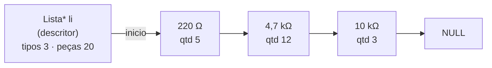
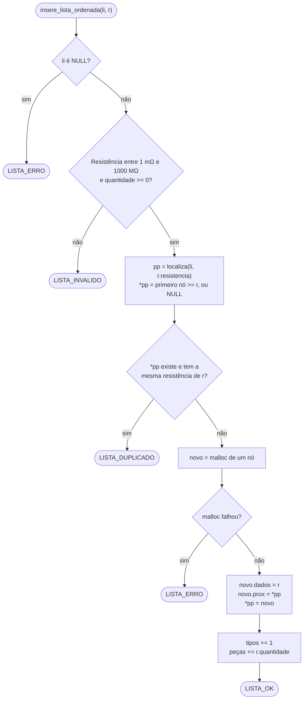
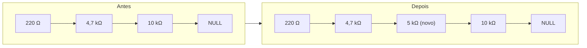
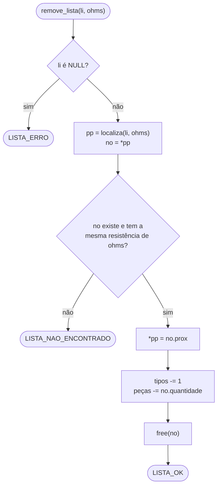
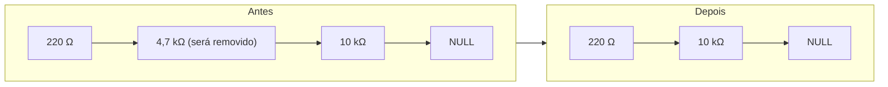
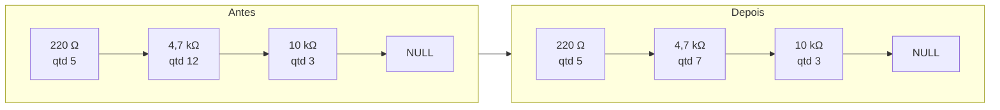
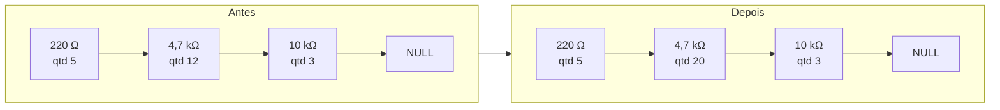

# OhmFlow

[](https://github.com/Grolla05/OhmFlow/actions/workflows/ci.yml)

Programa em C que controla o estoque de resistores do almoxarifado de um laboratório usando uma **lista dinâmica ordenada**. Desenvolvido para a disciplina de Estrutura de Dados e Recuperação da Informação (Projeto 01).

## Instalação rápida (Windows 10/11)

Para só **usar** o programa, não é preciso instalar compilador nem nada pelo PowerShell:

1. Baixe o `ohm_flow_setup.exe` da última versão em [Releases](https://github.com/Grolla05/OhmFlow/releases).
2. Execute e avance o assistente. Por padrão ele instala só para o seu usuário, sem pedir administrador, em `%LOCALAPPDATA%\Programs\OhmFlow`.
3. Abra o **OhmFlow** pelo Menu Iniciar.

Opções do assistente:

| Opção | Efeito |
| --- | --- |
| Instalar para todos os usuários | instala em `C:\Program Files\OhmFlow` (pede administrador) |
| Criar um atalho na área de trabalho | atalho no desktop |
| Adicionar o OhmFlow ao PATH | permite rodar `ohmflow` em qualquer terminal (abra um terminal novo depois) |

Para desinstalar, use **Configurações → Aplicativos → Aplicativos instalados → OhmFlow**, ou o atalho "Desinstalar OhmFlow" no Menu Iniciar. O PATH também é limpo.

O instalador não é assinado digitalmente. Por isso, o Windows SmartScreen pode mostrar "O Windows protegeu o computador". Clique em **Mais informações → Executar assim mesmo**.

O programa depende só de DLLs que já vêm no Windows 10/11 (`KERNEL32`, `USER32` e a UCRT). O MSYS2, o gcc e o make descritos mais abaixo servem apenas para **compilar** o código.

## Funcionalidades

| Opção | Função | Descrição |
| --- | --- | --- |
| 1 | Novo | cadastra um novo tipo de resistor (resistência + quantidade), um por vez ou em massa |
| 2 | Remover | apaga um tipo de resistor da lista, com confirmação |
| 3 | Listar | tabela de todos os tipos em ordem crescente, impressos em mΩ / Ω / kΩ / MΩ |
| 4 | Consultar | mostra a quantidade disponível de uma resistência |
| 5 | Retirar | dá baixa de uma quantidade no estoque |
| 6 | Repor | soma uma quantidade ao estoque |
| 7 | Inicializar/Reinicializar | esvazia a lista, com aviso e confirmação |
| 8 | Diferencial | a definir |
| 9 | Histórico | últimas 15 ações (dos logs dos últimos 30 dias), mais recentes primeiro |
| `Esc` / `0` | Sair | encerra o programa e libera a memória |

### Novo: um item ou vários de uma vez

A primeira linha digitada decide o modo:

- **Só a resistência** (ex.: `4k7`): a tela pergunta a quantidade e cadastra um item, como sempre.
- **Resistência e quantidade** (ex.: `4k7 50`): entra na inserção em massa. Digite um item por linha e encerre com **Enter vazio**. Uma linha só com a resistência pede a quantidade em separado. Duplicados e linhas inválidas não interrompem: ao final, uma caixa de resumo mostra quantos itens foram inseridos, quantos eram duplicados e quantos eram inválidos.

```text
» Resistência: 10k 5
  ✔ 10 kΩ inserido (5 un.)
» Resistência [quantidade]: 22k 3
  ✔ 22 kΩ inserido (3 un.)
» Resistência [quantidade]: 10k 1
  ⚠ 10 kΩ já cadastrado - ignorado
» Resistência [quantidade]:
┌─ ✔ SUCESSO ──────────────────────────┐
│ Inserção em massa concluída          │
│ Inseridos : 2                        │
│ Duplicados: 1                        │
│ Inválidos : 0                        │
└──────────────────────────────────────┘
```

### Teclas do menu

| Tecla | Ação |
| --- | --- |
| Setas ou `W` `A` `S` `D` | move a seleção |
| `1` a `9` | abre a opção direto |
| `Enter` | confirma a opção selecionada |
| `Esc` ou `0` | sai do programa na hora |

### Como digitar resistências

A lista guarda os valores em Ω, mas a entrada aceita os formatos usados no laboratório:

| Digitado | Valor |
| --- | --- |
| `220`, `220R`, `220 ohm` | 220 Ω |
| `4700`, `4.7k`, `4,7k`, `4k7`, `4K7` | 4,7 kΩ |
| `1M`, `1M5` | 1 MΩ, 1,5 MΩ |
| `470m`, `0.47`, `0,47` | 470 mΩ |
| `4R7` | 4,7 Ω |

Atenção: `m` minúsculo é mili e `M` maiúsculo é mega. A faixa aceita vai de 1 mΩ a 1000 MΩ. Deixar a resposta em branco (só Enter) cancela a operação.

## Estrutura

```text
src/
├── lista.h / lista.c             TAD lista dinâmica ordenada (chave: resistência)
├── formatacao.h / formatacao.c   leitura "4k7" -> Ω e impressão por grandeza
├── log.h / log.c                 registro das ações em logs/ohmflow_AAAA-MM-DD.log
├── main.c                        cria a lista, abre/fecha a sessão de log e conduz as telas
└── ui/
    ├── ui.h / ui.c               cores ANSI, molduras, tabelas, leitura de entrada
    └── telas.h / telas.c         boas-vindas, menu, telas das funções, feedback, encerramento
tests/
├── test_framework.h              mini framework de testes (sem dependências)
├── test_lista.c                  testes da lista
├── test_formatacao.c             testes de parse e formatação
├── test_log.c                    testes do log (formato, sessão, falhas de I/O)
├── test_ui.c                     testes de alinhamento, cores e espera por Enter
├── test_telas.c                  testes da navegação do menu
├── test_novo.c                   testes da tela Novo (parse_item, inserção em massa) e ajustes de tela
└── e2e/                          teste ponta a ponta: entrada simulada e saída esperada
```

## Como os dados são guardados

Os dados ficam **somente na memória RAM**, em uma **lista simplesmente encadeada** (não é array). Não há arquivo nem banco de dados: ao encerrar o programa, tudo é liberado e o estoque é perdido. O que fica gravado em disco é só o [registro de ações](#registro-de-ações-logs), não o estoque.

Cada nó guarda um resistor e o ponteiro para o próximo. A lista é mantida **sempre em ordem crescente de resistência**, porque a inserção já coloca o nó na posição certa. Nada é reorganizado depois.

A lista tem um **nó descritor**: uma estrutura à parte que guarda o ponteiro para o primeiro nó e os totais de tipos e de peças. Os totais são atualizados a cada inserção, remoção, retirada ou reposição, então `tamanho_lista` e `total_pecas` respondem em O(1), sem percorrer a lista.



```c
typedef struct { double resistencia; int quantidade; } Resistor;

struct elemento {
    Resistor         dados;  /* resistência em Ω (chave) e quantidade */
    struct elemento *prox;   /* próximo nó, ou NULL no último         */
};

struct descritor {           /* "Lista" (opaca para quem usa lista.h)  */
    struct elemento *inicio; /* primeiro nó, ou NULL se vazia          */
    int       tipos;         /* quantidade de nós                      */
    long long pecas;         /* soma das quantidades                   */
    int       passos;        /* nós examinados pela última busca       */
};
```

Todas as funções abaixo ficam em [src/lista.c](src/lista.c) e devolvem um código de retorno (`LISTA_OK`, `LISTA_DUPLICADO`, `LISTA_NAO_ENCONTRADO`, `LISTA_SEM_ESTOQUE`, `LISTA_INVALIDO` ou `LISTA_ERRO`), que a interface transforma em mensagem para o usuário.

### Busca: `localiza` (ponteiro para ponteiro)

Todas as operações começam pela mesma função interna, `localiza(li, ohms)`. Ela percorre a lista e **para no primeiro nó com resistência maior ou igual** à procurada; graças à ordenação, não precisa ir até o fim. Em vez do nó, devolve o **endereço do ponteiro** que aponta para ele (`Elem **pp`): o campo `inicio` do descritor ou o `prox` do nó anterior. Assim, inserir ou remover no início, no meio ou no fim da lista é o mesmo código, sem ponteiro `ant` nem caso especial para o primeiro nó.

`localiza` também conta os nós examinados. O total fica disponível em `lista_passos(li)` (usado nos testes; a tela não o mostra):

| Lista `220 Ω → 4,7 kΩ → 10 kΩ`, procurando | Nós visitados | Por quê |
| --- | --- | --- |
| 100 Ω | 1 | o primeiro nó já é maior: para ali |
| 4,7 kΩ | 2 | achou no segundo |
| 5 kΩ | 3 | para em 10 kΩ, que é maior |
| 1 MΩ | 3 | chega ao fim da lista |

### Inserir um resistor

`insere_lista_ordenada` usa `localiza` para chegar ao primeiro nó com resistência maior ou igual à nova. Se for igual, recusa (duplicado). Senão, cria o nó e ajusta **só dois ponteiros**, sem deslocar nenhum outro elemento.



Exemplo: inserir **5 kΩ** em `220 Ω → 4,7 kΩ → 10 kΩ`.



O percurso para em `10 kΩ` (primeiro nó que não é menor que 5 kΩ), e `pp` é o endereço do campo `prox` do `4,7 kΩ`. O novo nó aponta para `10 kΩ` e, ao escrever `*pp = novo`, o `4,7 kΩ` passa a apontar para o novo nó.

Casos de borda (todos resolvidos pelas mesmas duas linhas `novo->prox = *pp; *pp = novo;`):

| Caso | O que acontece |
| --- | --- |
| Menor que todos (ex.: 100 Ω) | `pp` é o endereço de `inicio` no descritor, então o novo nó vira o início da lista |
| Maior que todos (ex.: 1 MΩ) | `*pp` é o `prox` NULL do último nó, então o novo nó vira o último |
| Resistência já cadastrada | nada é inserido, retorna `LISTA_DUPLICADO` |
| Fora da faixa ou quantidade negativa | retorna `LISTA_INVALIDO` |

### Remover um resistor

`remove_lista` usa `localiza` para obter o endereço do ponteiro que aponta para o nó. Basta trocar esse ponteiro para o nó seguinte e liberar o nó com `free`. A busca **para cedo** quando passa do valor procurado, graças à ordenação.



Exemplo: remover **4,7 kΩ** de `220 Ω → 4,7 kΩ → 10 kΩ`.



O percurso para em `4,7 kΩ` (primeiro nó que não é menor que o procurado), e `pp` é o endereço do campo `prox` do `220 Ω`. Com `*pp = no->prox`, o `220 Ω` passa a apontar direto para o `10 kΩ`, e o nó removido é liberado com `free`.

Casos de borda:

| Caso | O que acontece |
| --- | --- |
| Remover o primeiro nó (ex.: 220 Ω) | `pp` é o endereço de `inicio` no descritor, então o início da lista passa a ser o segundo nó |
| Remover o último nó (ex.: 10 kΩ) | o `prox` do penúltimo nó recebe o `prox` NULL do último |
| Resistência não cadastrada | nada muda, retorna `LISTA_NAO_ENCONTRADO` |

### Editar o estoque (Retirar e Repor)

O programa não tem uma função de "editar resistência". O que se altera é a **quantidade** de um tipo já cadastrado, por Retirar (baixa) e Repor (soma). As duas usam a mesma busca ordenada (`localiza`) para achar o nó e mexem só no campo `quantidade` (e no total de peças do descritor): a lista não muda de forma e a ordem é preservada.


Exemplo de **Retirar 5 unidades de 4,7 kΩ** (estoque de 12). Só o campo `quantidade` do nó muda; os ponteiros e a ordem ficam iguais.



Exemplo de **Repor 8 unidades de 4,7 kΩ** (estoque de 12):



Detalhes:

- **Retirar até zerar** é permitido: o tipo continua cadastrado com quantidade 0. Para apagá-lo de vez, use Remover.
- **Consultar** (`consulta_lista`) usa a mesma busca, só lê a quantidade e não altera nada.
- Para **trocar o valor de uma resistência** cadastrada errada, remova o tipo e insira de novo com o valor certo. A chave de ordenação nunca é alterada no lugar.

### Outras operações

| Função | Como funciona |
| --- | --- |
| Listar | `percorre_lista` visita cada nó do início ao fim, já em ordem crescente |
| Tipos e peças (menu, Listar, encerramento) | `tamanho_lista` e `total_pecas` leem os totais do descritor, em O(1) |
| Reinicializar | `reinicializa_lista` dá `free` em todos os nós, deixa `inicio` em `NULL` e zera os totais |
| Sair | `libera_lista` libera todos os nós e o próprio descritor |

### Chave de ordenação exata

O texto digitado é convertido para Ω por um único `strtod` sobre a forma decimal com expoente (`"470m"` vira `"470.0e-3"`). Assim, grafias diferentes do mesmo valor (`470m`, `0.47`, `0,47`) geram exatamente o mesmo `double`. Multiplicar por `0,001` não garantia isso, porque esse número não é exato em binário. A comparação com tolerância (`mesma_resistencia`) continua como rede de segurança.

## Registro de ações (logs)

Cada execução do programa é uma **sessão** gravada no arquivo de log do dia, `ohmflow_AAAA-MM-DD.log` (texto UTF-8; várias sessões no mesmo dia vão sendo acrescentadas). Toda ação vira uma linha: inserir, remover, listar, consultar, retirar, repor, reinicializar, e também cancelamentos, valores inválidos e opções de menu inválidas.

```text
================================================================
 OhmFlow — sessão iniciada em 27/10/2026 14:03:12
================================================================
27/10/2026 14:03:20 | INFO  | NOVO          | 4,7 kΩ     | qtd 50               | OK
27/10/2026 14:03:41 | INFO  | REPOR         | 4,7 kΩ     | +10 (50→60)          | OK
27/10/2026 14:04:01 | AVISO | RETIRAR       | 4,7 kΩ     | -70 (tem 60)         | SEM ESTOQUE
27/10/2026 14:04:15 | ERRO  | NOVO          | "abc"      | -                    | VALOR INVÁLIDO
27/10/2026 14:05:02 | INFO  | REINICIALIZAR | -          | 3 tipos (68 peças)   | OK
================================================================
 OhmFlow — sessão encerrada em 27/10/2026 14:06:10 (3m 0s)
================================================================
```

Colunas: data e hora, nível (`INFO`, `AVISO`, `ERRO`), ação, resistor (ou o texto digitado, entre aspas), detalhe e resultado. Cada linha é gravada na hora, então o registro sobrevive mesmo se a janela for fechada.

Onde fica a pasta `logs`:

| Como o programa foi gerado | Pasta |
| --- | --- |
| `make` / `make run` (desenvolvimento) | `logs\` na pasta atual (ignorada pelo git) |
| Instalador (`make setup`, compilado com `-DOHM_LOGS_APPDATA`) | `%APPDATA%\OhmFlow\logs\` |
| Variável `OHMFLOW_LOGS_DIR` definida (usada pelo `make e2e`) | a pasta indicada |

Se a pasta não puder ser criada, o programa avisa uma vez e segue normalmente, sem registro.

## Compilar a partir do código: pré-requisitos (Windows 10/11)

Esta parte é para quem vai **desenvolver** ou compilar. Para só usar, veja a [Instalação rápida](#instalação-rápida-windows-1011).

O OhmFlow é suportado **somente no Windows**. Este guia parte de um computador sem nenhuma ferramenta de programação e usa **só o PowerShell**: não é preciso abrir nenhum outro terminal.

| Ferramenta | Para que serve | Obrigatória? |
| --- | --- | --- |
| **Git** | baixar (clonar) o código do GitHub | sim (ou baixe o ZIP pelo site) |
| **gcc** | compilador C que gera o executável | sim |
| **make** | roda os comandos de build e de teste do `Makefile` | sim |
| **cppcheck** | análise estática do código (`make cppcheck`) | não |
| **Inno Setup 6** | gera o instalador `ohm_flow_setup.exe` (`make setup`) | não |

As quatro ferramentas vêm do [MSYS2](https://www.msys2.org/), que instala no Windows o gerenciador de pacotes `pacman`. Abra o **PowerShell** e siga os passos em ordem.

**1. Instale o MSYS2** (a pasta padrão é `C:\msys64`):

```powershell
winget install --id MSYS2.MSYS2 -e
```

**2. Atualize o MSYS2.** Rode o comando **duas vezes**: na primeira, o `pacman` atualiza o próprio núcleo; na segunda, o resto dos pacotes.

```powershell
C:\msys64\usr\bin\bash.exe -lc "pacman -Syu --noconfirm"
```

**3. Instale as ferramentas:**

```powershell
C:\msys64\usr\bin\bash.exe -lc "pacman -S --needed --noconfirm git make mingw-w64-ucrt-x86_64-gcc mingw-w64-ucrt-x86_64-cppcheck"
```

**4. Coloque as ferramentas no `Path`.** O PowerShell precisa enxergar duas pastas do MSYS2: `C:\msys64\ucrt64\bin` (gcc, cppcheck) e `C:\msys64\usr\bin` (make, git e utilitários que o `Makefile` usa). Rode uma vez e **abra um PowerShell novo**:

```powershell
$atual = [Environment]::GetEnvironmentVariable('Path', 'User')
[Environment]::SetEnvironmentVariable('Path', "$atual;C:\msys64\ucrt64\bin;C:\msys64\usr\bin", 'User')
```

As pastas entram no **fim** do `Path`, assim os comandos do Windows com o mesmo nome (`find`, `sort`...) continuam valendo. Para testar sem mexer no `Path` permanente, use só na janela atual:

```powershell
$env:Path += ';C:\msys64\ucrt64\bin;C:\msys64\usr\bin'
```

**5. Confira a instalação.** Cada comando deve imprimir uma versão:

```powershell
gcc --version
make --version
git --version
cppcheck --version
```

## Baixar o projeto

No PowerShell, vá até a pasta onde quer guardar o projeto e clone:

```powershell
cd D:\GitHub        # exemplo: qualquer pasta serve
git clone https://github.com/Grolla05/OhmFlow.git
cd OhmFlow
```

Sem Git, também dá para baixar o ZIP no GitHub (**Code → Download ZIP**), extrair e abrir a pasta no PowerShell com `cd`.

## Compilar e executar

O executável final sai na pasta **`dist/`**. Os arquivos intermediários e os testes ficam em `build/`. As duas pastas são ignoradas pelo Git.

Na pasta do projeto, no PowerShell:

```powershell
make            # compila dist\ohmflow.exe
make clean      # remove build/ e dist/
```

Para executar:

```powershell
.\dist\ohmflow.exe
```

Rode pelo **Windows Terminal, PowerShell ou cmd**. O terminal do MSYS2 (mintty) não é reconhecido como console interativo: nele, cores, limpeza de tela e pausas ficam desligadas.

O `ohmflow.exe` depende só de DLLs do próprio Windows. Ele roda fora do MSYS2, e a pasta `dist/` pode ser copiada para outro computador com Windows.

### Opções

- `$env:NO_COLOR=1`: desliga as cores.
- `make EXTRA_CFLAGS=-DOHM_ASCII`: troca molduras e símbolos Unicode por ASCII (`+-|`, `ohm`), para terminais sem UTF-8.

### Gerar o instalador

O instalador é gerado com o [Inno Setup 6](https://jrsoftware.org/isinfo.php) a partir do script [installer/ohmflow.iss](installer/ohmflow.iss). Instale uma vez:

```powershell
winget install JRSoftware.InnoSetup
```

Depois, na pasta do projeto:

```powershell
make setup                 # gera dist\ohm_flow_setup.exe (versão padrão 1.0.0)
make setup VERSAO=1.2.0    # define a versão do setup e do exe (Propriedades > Detalhes)
make teste-setup           # gera, instala em silêncio, roda o programa instalado e desinstala
```

O exe que vai no instalador é compilado à parte (`dist\instalador\ohmflow.exe`, com `-DOHM_LOGS_APPDATA`) e grava os logs em `%APPDATA%\OhmFlow\logs`, já que a pasta de instalação pode não aceitar escrita. O `make teste-setup` confere isso usando um `APPDATA` temporário.

O `make setup` encontra o `ISCC.exe` no `Path`, em `C:\Program Files (x86)\Inno Setup 6` ou em `%LOCALAPPDATA%\Programs\Inno Setup 6` (onde o winget instala por usuário). Ao trocar a `VERSAO`, rode `make clean` antes, para o recurso de versão do exe ser recompilado.

No CI, cada push gera o instalador como *artifact* (`ohm_flow_setup`). Um push de tag `v*` (ex.: `git tag v1.0.0; git push origin v1.0.0`) cria o Release no GitHub com o `ohm_flow_setup.exe` anexado.

### Problemas comuns

| Sintoma | Causa / solução |
| --- | --- |
| `gcc` ou `make` não reconhecido no PowerShell | As pastas do MSYS2 não estão no `Path`. Refaça o passo 4 e abra um PowerShell novo. |
| `winget` não reconhecido | Instale o **App Installer** pela Microsoft Store, ou baixe o instalador em [msys2.org](https://www.msys2.org/) e aceite a pasta `C:\msys64`. |
| `Ω` e bordas aparecem como `Ω` ou `â•”` | O terminal não está em UTF-8. Use o Windows Terminal ou compile com `-DOHM_ASCII`. |
| Sem cores, sem limpar tela, sem pausas | O programa está rodando no mintty (terminal do MSYS2) ou com entrada/saída redirecionada. Execute no Windows Terminal. |

## Testes

No PowerShell, na pasta do projeto:

```powershell
make test       # testes unitários (lista, formatação, log, ui, telas)
make e2e        # roda o programa com tests/e2e/entrada.txt, confere tests/e2e/esperado.txt e o log em build/e2e_logs
make cppcheck   # análise estática
```

Para validar tudo de uma vez:

```powershell
make clean; make EXTRA_CFLAGS=-Werror all test e2e cppcheck
```

O GitHub Actions ([.github/workflows/ci.yml](.github/workflows/ci.yml)) roda a cada push ou pull request em `main` e `Grolla`, num único job **Windows** (`windows-latest`, MSYS2 UCRT64): `make all test e2e` com `-Werror`, a checagem de subsistema console, `make cppcheck` e `make teste-setup` (instalador gerado e testado).

O ícone `src/assets/logo/ohmflow.ico` é versionado, então o build não precisa de Python. Se trocar o `logo.png`, regenere o ícone com `make icone` (requer Python com Pillow) e faça commit do `.ico`.

## Referência

O enunciado do projeto está em [refs/Aula_07_Projeto01_22_10_2026.pdf](refs/Aula_07_Projeto01_22_10_2026.pdf).
