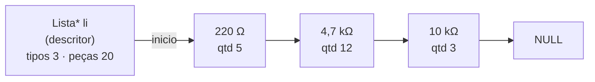
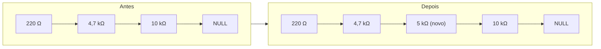
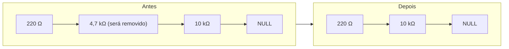
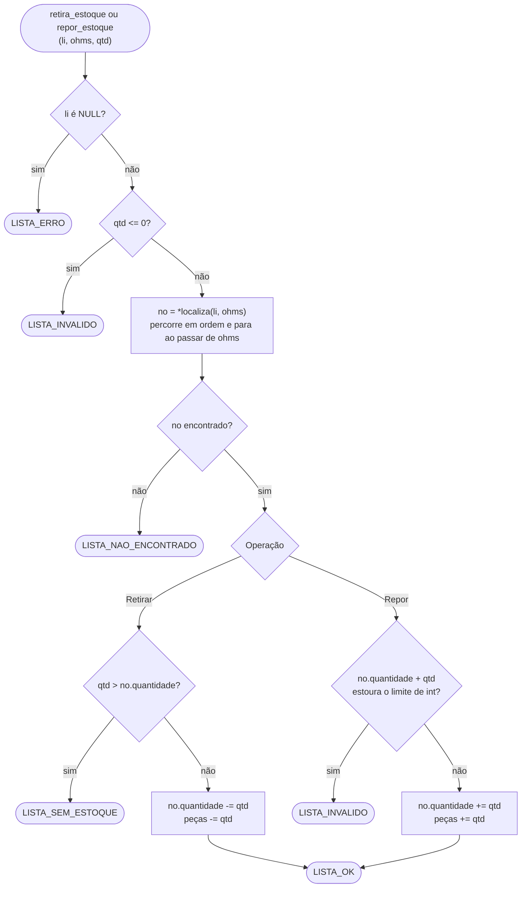
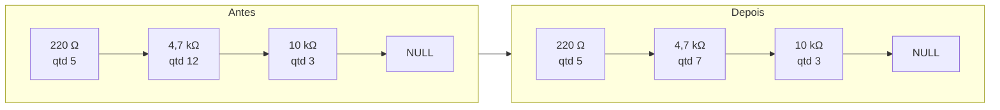
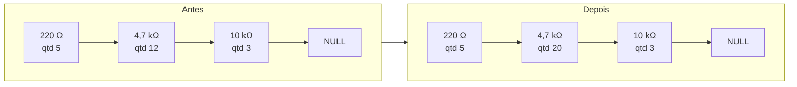

# OhmFlow

[](https://github.com/Grolla05/OhmFlow/actions/workflows/ci.yml)

Programa em C que controla o estoque de resistores do almoxarifado de um laboratório usando uma **lista dinâmica ordenada**. Desenvolvido para a disciplina de Estrutura de Dados e Recuperação da Informação (Projeto 01).

## Funcionalidades

| Opção | Função | Descrição |
| --- | --- | --- |
| 1 | Inserir | cadastra um novo tipo de resistor (resistência + quantidade) |
| 2 | Remover | apaga um tipo de resistor da lista, com confirmação |
| 3 | Listar | tabela de todos os tipos em ordem crescente, impressos em mΩ / Ω / kΩ / MΩ |
| 4 | Consultar | mostra a quantidade disponível de uma resistência |
| 5 | Retirar | dá baixa de uma quantidade no estoque |
| 6 | Repor | soma uma quantidade ao estoque |
| 7 | Inicializar/Reinicializar | esvazia a lista, com confirmação |
| 8 | Diferencial | a definir |
| 0 | Sair | encerra o programa e libera a memória |

### Como digitar resistências

A lista guarda os valores em Ω, mas a entrada aceita os formatos usados no laboratório:

| Digitado | Valor |
| --- | --- |
| `220`, `220R`, `220 ohm` | 220 Ω |
| `4700`, `4.7k`, `4,7k`, `4k7`, `4K7` | 4,7 kΩ |
| `1M`, `1M5` | 1 MΩ, 1,5 MΩ |
| `470m`, `0.47`, `0,47` | 470 mΩ |
| `4R7` | 4,7 Ω |

Atenção: `m` minúsculo é mili e `M` maiúsculo é mega. A faixa aceita vai de 1 mΩ a 1000 MΩ. Deixar a resposta em branco (só Enter) cancela a operação.

## Estrutura

```text
src/
├── lista.h / lista.c             TAD lista dinâmica ordenada (chave: resistência)
├── formatacao.h / formatacao.c   leitura "4k7" -> Ω e impressão por grandeza
├── main.c                        cria a lista e conduz as telas
└── ui/
    ├── ui.h / ui.c               cores ANSI, molduras, tabelas, leitura de entrada
    └── telas.h / telas.c         boas-vindas, menu, telas das funções, feedback, encerramento
tests/
├── test_framework.h              mini framework de testes (sem dependências)
├── test_lista.c                  testes da lista
├── test_formatacao.c             testes de parse e formatação
├── test_ui.c                     testes de alinhamento e cores
└── e2e/                          teste ponta a ponta: entrada simulada e saída esperada
```

## Como os dados são guardados

Os dados ficam **somente na memória RAM**, em uma **lista simplesmente encadeada** (não é array). Não há arquivo nem banco de dados: ao encerrar o programa, tudo é liberado e o estoque é perdido.

Cada nó guarda um resistor e o ponteiro para o próximo. A lista é mantida **sempre em ordem crescente de resistência**, porque a inserção já coloca o nó na posição certa. Nada é reorganizado depois.

A lista tem um **nó descritor**: uma estrutura à parte que guarda o ponteiro para o primeiro nó e os totais de tipos e de peças. Os totais são atualizados a cada inserção, remoção, retirada ou reposição, então `tamanho_lista` e `total_pecas` respondem em O(1), sem percorrer a lista.



```c
typedef struct { double resistencia; int quantidade; } Resistor;

struct elemento {
    Resistor         dados;  /* resistência em Ω (chave) e quantidade */
    struct elemento *prox;   /* próximo nó, ou NULL no último         */
};

struct descritor {           /* "Lista" (opaca para quem usa lista.h)  */
    struct elemento *inicio; /* primeiro nó, ou NULL se vazia          */
    int       tipos;         /* quantidade de nós                      */
    long long pecas;         /* soma das quantidades                   */
    int       passos;        /* nós examinados pela última busca       */
};
```

Todas as funções abaixo ficam em [src/lista.c](src/lista.c) e devolvem um código de retorno (`LISTA_OK`, `LISTA_DUPLICADO`, `LISTA_NAO_ENCONTRADO`, `LISTA_SEM_ESTOQUE`, `LISTA_INVALIDO` ou `LISTA_ERRO`), que a interface transforma em mensagem para o usuário.

### Busca: `localiza` (ponteiro para ponteiro)

Todas as operações começam pela mesma função interna, `localiza(li, ohms)`. Ela percorre a lista e **para no primeiro nó com resistência maior ou igual** à procurada; graças à ordenação, não precisa ir até o fim. Em vez do nó, devolve o **endereço do ponteiro** que aponta para ele (`Elem **pp`): o campo `inicio` do descritor ou o `prox` do nó anterior. Assim, inserir ou remover no início, no meio ou no fim da lista é o mesmo código, sem ponteiro `ant` nem caso especial para o primeiro nó.

`localiza` também conta os nós examinados. O total fica disponível em `lista_passos(li)`, e a tela **Consultar** mostra o resultado:

```text
  4,7 kΩ → 12 unidades
  Busca: 2 nós visitados
```

| Lista `220 Ω → 4,7 kΩ → 10 kΩ`, procurando | Nós visitados | Por quê |
| --- | --- | --- |
| 100 Ω | 1 | o primeiro nó já é maior: para ali |
| 4,7 kΩ | 2 | achou no segundo |
| 5 kΩ | 3 | para em 10 kΩ, que é maior |
| 1 MΩ | 3 | chega ao fim da lista |

### Inserir um resistor

`insere_lista_ordenada` usa `localiza` para chegar ao primeiro nó com resistência maior ou igual à nova. Se for igual, recusa (duplicado). Senão, cria o nó e ajusta **só dois ponteiros**, sem deslocar nenhum outro elemento.


Exemplo: inserir **5 kΩ** em `220 Ω → 4,7 kΩ → 10 kΩ`.



O percurso para em `10 kΩ` (primeiro nó que não é menor que 5 kΩ), e `pp` é o endereço do campo `prox` do `4,7 kΩ`. O novo nó aponta para `10 kΩ` e, ao escrever `*pp = novo`, o `4,7 kΩ` passa a apontar para o novo nó.

Casos de borda (todos resolvidos pelas mesmas duas linhas `novo->prox = *pp; *pp = novo;`):

| Caso | O que acontece |
| --- | --- |
| Menor que todos (ex.: 100 Ω) | `pp` é o endereço de `inicio` no descritor, então o novo nó vira o início da lista |
| Maior que todos (ex.: 1 MΩ) | `*pp` é o `prox` NULL do último nó, então o novo nó vira o último |
| Resistência já cadastrada | nada é inserido, retorna `LISTA_DUPLICADO` |
| Fora da faixa ou quantidade negativa | retorna `LISTA_INVALIDO` |

### Remover um resistor

`remove_lista` usa `localiza` para obter o endereço do ponteiro que aponta para o nó. Basta trocar esse ponteiro para o nó seguinte e liberar o nó com `free`. A busca **para cedo** quando passa do valor procurado, graças à ordenação.


Exemplo: remover **4,7 kΩ** de `220 Ω → 4,7 kΩ → 10 kΩ`.



O percurso para em `4,7 kΩ` (primeiro nó que não é menor que o procurado), e `pp` é o endereço do campo `prox` do `220 Ω`. Com `*pp = no->prox`, o `220 Ω` passa a apontar direto para o `10 kΩ`, e o nó removido é liberado com `free`.

Casos de borda:

| Caso | O que acontece |
| --- | --- |
| Remover o primeiro nó (ex.: 220 Ω) | `pp` é o endereço de `inicio` no descritor, então o início da lista passa a ser o segundo nó |
| Remover o último nó (ex.: 10 kΩ) | o `prox` do penúltimo nó recebe o `prox` NULL do último |
| Resistência não cadastrada | nada muda, retorna `LISTA_NAO_ENCONTRADO` |

### Editar o estoque (Retirar e Repor)

O programa não tem uma função de "editar resistência". O que se altera é a **quantidade** de um tipo já cadastrado, por Retirar (baixa) e Repor (soma). As duas usam a mesma busca ordenada (`localiza`) para achar o nó e mexem só no campo `quantidade` (e no total de peças do descritor): a lista não muda de forma e a ordem é preservada.



Exemplo de **Retirar 5 unidades de 4,7 kΩ** (estoque de 12). Só o campo `quantidade` do nó muda; os ponteiros e a ordem ficam iguais.



Exemplo de **Repor 8 unidades de 4,7 kΩ** (estoque de 12):



Detalhes:

- **Retirar até zerar** é permitido: o tipo continua cadastrado com quantidade 0. Para apagá-lo de vez, use Remover.
- **Consultar** (`consulta_lista`) usa a mesma busca, só lê a quantidade e não altera nada. A tela mostra também quantos nós a busca visitou (`lista_passos`).
- Para **trocar o valor de uma resistência** cadastrada errada, remova o tipo e insira de novo com o valor certo. A chave de ordenação nunca é alterada no lugar.

### Outras operações

| Função | Como funciona |
| --- | --- |
| Listar | `percorre_lista` visita cada nó do início ao fim, já em ordem crescente |
| Tipos e peças (menu, Listar, encerramento) | `tamanho_lista` e `total_pecas` leem os totais do descritor, em O(1) |
| Reinicializar | `reinicializa_lista` dá `free` em todos os nós, deixa `inicio` em `NULL` e zera os totais |
| Sair | `libera_lista` libera todos os nós e o próprio descritor |

### Chave de ordenação exata

O texto digitado é convertido para Ω por um único `strtod` sobre a forma decimal com expoente (`"470m"` vira `"470.0e-3"`). Assim, grafias diferentes do mesmo valor (`470m`, `0.47`, `0,47`) geram exatamente o mesmo `double`. Multiplicar por `0,001` não garantia isso, porque esse número não é exato em binário. A comparação com tolerância (`mesma_resistencia`) continua como rede de segurança.

## Instalação dos pré-requisitos

Este guia parte de um computador sem nenhuma ferramenta de programação instalada. Você vai precisar de:

| Ferramenta | Para que serve | Obrigatória? |
| --- | --- | --- |
| **Git** | baixar (clonar) o código do GitHub | sim (ou baixe o ZIP pelo site) |
| **gcc** | compilador C que gera o executável | sim |
| **make** | roda os comandos de build e de teste do `Makefile` | sim |
| **cppcheck** | análise estática do código (`make cppcheck`) | não |

### Windows 10/11 — MSYS2

O [MSYS2](https://www.msys2.org/) instala no Windows um terminal estilo Linux com o gerenciador de pacotes `pacman`, de onde vêm o gcc, o make e o git.

**1. Instale o MSYS2.** Escolha uma das opções:

- Pelo **PowerShell** (já vem com o Windows):

  ```powershell
  winget install --id MSYS2.MSYS2 -e
  ```

- Ou baixe o instalador em [msys2.org](https://www.msys2.org/), execute e aceite a pasta padrão `C:\msys64`.

**2. Abra o terminal certo.** No menu Iniciar, procure e abra **MSYS2 UCRT64**. Há vários atalhos do MSYS2 (MSYS, MINGW64, CLANG64...), e os comandos abaixo só funcionam no **UCRT64**. Para conferir, rode:

```sh
echo $MSYSTEM     # deve mostrar: UCRT64
```

**3. Atualize o MSYS2.** No terminal UCRT64:

```sh
pacman -Syu
```

Responda `Y` quando perguntar. Se o terminal pedir para fechar, feche, abra o **MSYS2 UCRT64** de novo e termine a atualização com:

```sh
pacman -Su
```

**4. Instale as ferramentas:**

```sh
pacman -S --needed git make mingw-w64-ucrt-x86_64-gcc mingw-w64-ucrt-x86_64-cppcheck
```

**5. Confira a instalação.** Cada comando deve imprimir uma versão:

```sh
gcc --version
make --version
git --version
cppcheck --version
```

> **Caminhos no MSYS2:** os discos do Windows aparecem como `/c/`, `/d/`... Por exemplo, `D:\GitHub` vira `/d/GitHub`. O terminal começa na sua pasta pessoal do MSYS2 (`~`).

#### Usar pelo PowerShell, sem abrir o MSYS2

Depois da instalação acima, o `gcc`, o `make` e o `git` também rodam direto no PowerShell. Basta o PowerShell enxergar duas pastas do MSYS2: `C:\msys64\ucrt64\bin` (gcc) e `C:\msys64\usr\bin` (make, git e utilitários que o `Makefile` usa).

Só na janela atual (vale até fechar o PowerShell):

```powershell
$env:Path += ';C:\msys64\ucrt64\bin;C:\msys64\usr\bin'
```

Ou de forma permanente, para todo PowerShell novo (rode uma vez e abra outro PowerShell):

```powershell
$atual = [Environment]::GetEnvironmentVariable('Path', 'User')
[Environment]::SetEnvironmentVariable('Path', "$atual;C:\msys64\ucrt64\bin;C:\msys64\usr\bin", 'User')
```

As pastas entram no **fim** do `Path`, assim os comandos do Windows com o mesmo nome (`find`, `sort`...) continuam valendo. Confira:

```powershell
gcc --version
make --version
```

### Linux

Debian/Ubuntu:

```sh
sudo apt update
sudo apt install -y build-essential git cppcheck
```

Fedora:

```sh
sudo dnf install -y gcc make git cppcheck
```

### macOS

```sh
xcode-select --install     # instala clang (atende pelo nome gcc), make e git
brew install cppcheck      # opcional; requer o Homebrew (https://brew.sh)
```

## Baixar o projeto

No **PowerShell** (Windows, após a seção acima) ou em qualquer terminal Linux/macOS, vá até a pasta onde quer guardar o projeto e clone:

```powershell
cd D:\GitHub        # exemplo no Windows; no Linux/macOS use qualquer pasta
git clone https://github.com/Grolla05/OhmFlow.git
cd OhmFlow
```

Sem Git, também dá para baixar o ZIP no GitHub (**Code → Download ZIP**), extrair e abrir a pasta no terminal com `cd`. Quem preferir o terminal **MSYS2 UCRT64** pode usá-lo: lá o caminho fica `/d/GitHub`.

## Compilar e executar

O executável final sai na pasta **`dist/`**. Os arquivos intermediários e os testes ficam em `build/`. As duas pastas são ignoradas pelo Git.

Na pasta do projeto, no **PowerShell** (Windows) ou no terminal (Linux/macOS):

```powershell
make            # compila dist/ohmflow (no Windows: dist\ohmflow.exe)
make clean      # remove build/ e dist/
```

Para executar:

```powershell
.\dist\ohmflow.exe      # Windows (PowerShell, cmd ou Windows Terminal)
./dist/ohmflow          # Linux/macOS
```

### Executando no Windows

Rode o `dist\ohmflow.exe` pelo **Windows Terminal, PowerShell ou cmd**, como acima. O terminal do MSYS2 (mintty) não é reconhecido como console interativo: nele, cores, limpeza de tela e pausas ficam desligadas.

O `ohmflow.exe` depende só de DLLs do próprio Windows. Ele roda fora do MSYS2, e a pasta `dist/` pode ser copiada para outro computador.

### Opções

- `NO_COLOR=1`: desliga as cores.
- `make EXTRA_CFLAGS=-DOHM_ASCII`: troca molduras e símbolos Unicode por ASCII (`+-|`, `ohm`), para terminais sem UTF-8.

### Problemas comuns

| Sintoma | Causa / solução |
| --- | --- |
| `gcc` ou `make` não reconhecido no PowerShell | As pastas do MSYS2 não estão no `Path`. Rode o comando de [Usar pelo PowerShell](#usar-pelo-powershell-sem-abrir-o-msys2) e abra um PowerShell novo se foi a versão permanente. |
| `gcc: command not found` no MSYS2 | O terminal aberto não é o **MSYS2 UCRT64** (`echo $MSYSTEM`), ou o passo 4 não foi feito. |
| `make: command not found` no MSYS2 | Rode `pacman -S make` no UCRT64. |
| `Ω` e bordas aparecem como `Ω` ou `â•”` | O terminal não está em UTF-8. Use o Windows Terminal ou compile com `-DOHM_ASCII`. |
| Sem cores, sem limpar tela, sem pausas | O programa está rodando no mintty ou com entrada/saída redirecionada. Execute no Windows Terminal. |
| `make asan` falha no Windows | É esperado: o gcc do MinGW não tem AddressSanitizer. Esse alvo roda no Linux e no CI. |

## Testes

Os mesmos comandos valem no PowerShell (Windows), no Linux e no macOS:

```powershell
make test       # testes unitários (lista, formatação, ui)
make e2e        # roda o programa com tests/e2e/entrada.txt e confere tests/e2e/esperado.txt
make asan       # testes + e2e com AddressSanitizer/UBSan (Linux; o gcc do MinGW não suporta)
make cppcheck   # análise estática
```

Para validar tudo de uma vez:

```powershell
make clean; make EXTRA_CFLAGS=-Werror all test e2e cppcheck
```

O GitHub Actions ([.github/workflows/ci.yml](.github/workflows/ci.yml)) roda a cada push ou pull request em `main` e `Grolla`, em dois jobs:

| Job | Ambiente | O que roda |
| --- | --- | --- |
| Build, testes e análise | Ubuntu (`ubuntu-latest`) | `make all test e2e` com `-Werror`, `make asan` e `make cppcheck` |
| Build e testes (Windows) | Windows (`windows-latest`, MSYS2 UCRT64) | `make all test e2e` com `-Werror`, cobrindo o código `#ifdef _WIN32`, o ícone (`windres`) e a checagem de subsistema console |

O ícone `src/assets/ohmflow.ico` é versionado, então o build não precisa de Python. Se trocar o `logo.png`, regenere o ícone com `make icone` (requer Python com Pillow) e faça commit do `.ico`.

## Referência

O enunciado do projeto está em [refs/Aula_07_Projeto01_22_10_2026.pdf](refs/Aula_07_Projeto01_22_10_2026.pdf).
