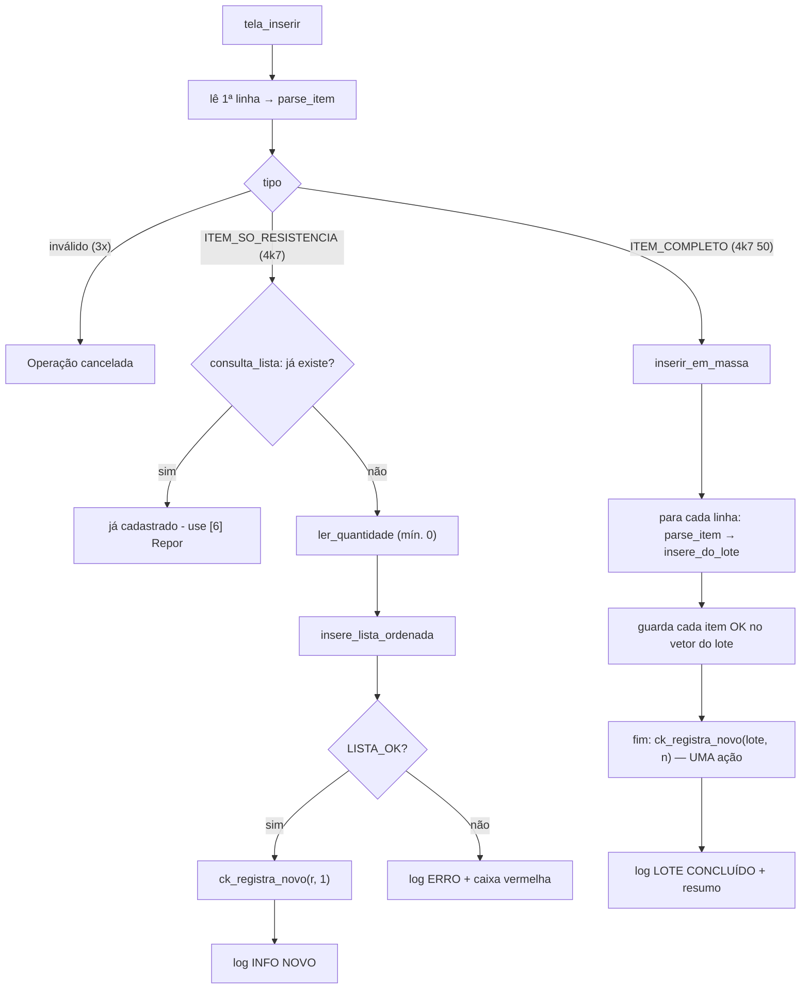

# 01 — Novo (cadastrar resistores)

← Anterior: [00 — Boas-vindas e menu](00-boas-vindas-e-menu.md) · [Funcionalidades](README.md) · Próximo: [02 — Remover](02-remover.md)

**Menu:** `[1] Novo`
**Código:** `tela_inserir`, `inserir_em_massa`, `insere_do_lote`, `guarda_no_lote`, `parse_item` em [src/ui/telas.c](../../src/ui/telas.c); `insere_lista_ordenada` em [src/lista.c](../../src/lista.c)
**Testes:** [tests/test_novo.c](../../tests/test_novo.c), [tests/test_lista.c](../../tests/test_lista.c), e2e

---

## 1. Para que serve

Cadastrar um **novo tipo** de resistor (um valor que ainda não existe no estoque) com a quantidade inicial. Funciona de dois jeitos: **um item por vez** ou **vários de uma vez** (em massa), útil quando chega uma caixa sortida.

## 2. Como usar

A **primeira linha** decide o modo.

### 2.1 Um item

1. Digite só a resistência: `4k7`.
2. O programa pergunta `Quantidade :`. Digite `10`.
3. Resultado: caixa verde *"Resistor 4,7 kΩ inserido (10 un.)"*.

### 2.2 Em massa

1. Digite resistência **e** quantidade na primeira linha: `10k 5`.
2. Continue, um item por linha, no prompt `Resistência [quantidade]:`.
3. Uma linha só com a resistência (`33k`) faz o programa perguntar a quantidade daquele item.
4. **Enter vazio** encerra o lote e mostra o resumo.

```text
» Resistência: 10k 5
  ✔ 10 kΩ inserido (5 un.)
» Resistência [quantidade]: 22k 3
  ✔ 22 kΩ inserido (3 un.)
» Resistência [quantidade]: 10k 1
  ⚠ 10 kΩ já cadastrado - ignorado
» Resistência [quantidade]: lixo 2
  ✖ Linha inválida: "lixo 2"
» Resistência [quantidade]: 33k
» Quantidade : 7
  ✔ 33 kΩ inserido (7 un.)
» Resistência [quantidade]:
┌─ ✔ SUCESSO ──────────────────────────┐
│ Inserção em massa concluída          │
│ Inseridos : 3                        │
│ Duplicados: 1                        │
│ Inválidos : 1                        │
└──────────────────────────────────────┘
```

### 2.3 Resistor colorido

No terminal com cores, a caixa do título desenha um resistor. Depois de cada resistência válida, a tela é redesenhada com as **faixas do código de cores** daquele valor (ex.: `4k7` → amarelo · violeta · vermelho · dourado) e, no lote, com o placar *"Lote até agora: N inseridos · N duplicados · N inválidos"*. Detalhes em [14 — Resistor colorido](14-resistor-colorido.md).

## 3. Regras e casos especiais

**Tabela 1 — O que pode acontecer**

| Situação | Modo um item | Modo em massa |
| --- | --- | --- |
| Valor já cadastrado | ✖ *"4,7 kΩ já cadastrado - use [6] Repor"*; nem pergunta a quantidade | ⚠ linha ignorada, conta como duplicado |
| Linha inválida (`abc`, `4.7.1`, campo a mais) | ✖ *"Valor inválido..."*; até 3 tentativas, depois cancela | ✖ *"Linha inválida"*, conta como inválido e segue |
| Quantidade inválida (negativa, texto) | Pergunta de novo (até 3) | Pergunta de novo; se desistir, *"Item sem quantidade ignorado"* |
| Quantidade 0 | Permitida (tipo cadastrado sem peças) | Permitida |
| Enter vazio na primeira pergunta | Cancela (*"Operação cancelada"*) | — |
| Enter vazio no lote | — | Encerra o lote e mostra o resumo |
| Fim da entrada (EOF) | Cancela | Encerra o lote |
| Duplicado digitado só com a resistência no lote | — | Nem pergunta a quantidade; vai direto para "já cadastrado" |

Limites: resistência de 1 mΩ a 1000 MΩ; quantidade de 0 a 2.147.483.647. Formatos aceitos em [12 — Entrada de valores](12-entrada-de-valores.md).

## 4. Por dentro



**Figura 1 — Fluxo do Novo**

Pontos importantes:

- **A inserção na lista é ordenada**: o nó novo já entra na posição certa (explicado em [modulos/lista.md](../modulos/lista.md#51-inserir)). A listagem nunca precisa ordenar.
- **`parse_item`** usa `sscanf("%127s %127s %1s")`: se sobrar um terceiro campo, a linha é inválida. A resistência passa por `parse_resistencia` e a quantidade por `parse_quantidade`.
- **O lote guarda os itens inseridos** num vetor dinâmico (`Lote.ok`) que **dobra de tamanho** quando enche (8, 16, 32...). Ao final, o lote inteiro vira **uma só** operação no checkpoint.
- Se faltar memória para guardar um item no vetor, o histórico de desfazer é **descartado** (`ck_descarta`), porque não daria mais para desfazer o lote corretamente. O cadastro em si continua valendo.

## 5. Registro no log

```text
| INFO  | NOVO          | 4,7 kΩ     | qtd 10               | OK
| AVISO | NOVO          | 4,7 kΩ     | -                    | JÁ CADASTRADO
| ERRO  | NOVO          | "abc"      | -                    | VALOR INVÁLIDO
| ERRO  | NOVO          | 4,7 kΩ     | "-5"                 | QUANTIDADE INVÁLIDA
| AVISO | NOVO          | -          | -                    | CANCELADO
| INFO  | NOVO          | 10 kΩ      | qtd 5 (lote)         | OK
| AVISO | NOVO          | 10 kΩ      | (lote)               | JÁ CADASTRADO
| AVISO | NOVO          | 33 kΩ      | (lote)               | SEM QUANTIDADE
| INFO  | NOVO          | -          | 3 ok · 1 dup · 1 inv | LOTE CONCLUÍDO
```

## 6. Desfazer

| Ação | Desfazer | Refazer |
| --- | --- | --- |
| Um item | Remove o item | Reinsere com a mesma quantidade |
| Lote | Remove **todos** os itens do lote de uma vez | Reinsere todos |

Ver [10 — Desfazer e refazer](10-desfazer-refazer.md).

## 7. Por que é assim

| Decisão | Motivo |
| --- | --- |
| Modo decidido pela primeira linha | Nenhuma pergunta extra ("um ou vários?"); quem digita `4k7 50` claramente quer agilidade |
| Duplicado não vira soma | Somar a um tipo existente é o papel do **Repor**; misturar os dois esconderia erros de digitação |
| Lote não para em erro | Numa caixa sortida, um item ruim não deve obrigar a redigitar tudo; o resumo mostra o que falhou |
| Lote = uma ação no desfazer | Para quem usou, foi "um cadastro" |
| Quantidade 0 permitida | Cadastrar um valor que se pretende comprar |

## 8. Testes

- `test_novo.c`: `parse_item` completo, só resistência, inválido e limite de `int`; Novo unitário e duplicado; em massa; EOF encerra o lote; primeira linha inválida tenta de novo; o lote recolore o resistor a cada item; sem terminal não há desenho.
- `test_resistor.c`: código de cores e desenho ([14 — Resistor colorido](14-resistor-colorido.md)).
- `test_lista.c`: inserção em lista vazia, no início/meio/fim, duplicado e inválido.
- `test_checkpoint.c`: desfazer e refazer Novo, lote desfeito em um passo.
- e2e: cadastra `4k7`, `220`, `470m`, `1M` um a um; tenta `4700` duplicado; lote `10k 5`, `22k 3`, `10k 1`, `lixo 2`, `33k`+`7`.

---

← Anterior: [00 — Boas-vindas e menu](00-boas-vindas-e-menu.md) · [Funcionalidades](README.md) · Próximo: [02 — Remover](02-remover.md)
