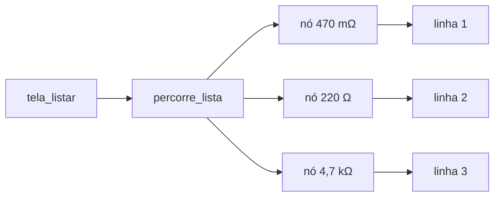

# 03 — Listar (ver o estoque)

← Anterior: [02 — Remover](02-remover.md) · [Funcionalidades](README.md) · Próximo: [04 — Consultar](04-consultar.md)

**Menu:** `[3] Listar`
**Código:** `tela_listar`, `linha_estoque` em [src/ui/telas.c](../../src/ui/telas.c); `percorre_lista` em [src/lista.c](../../src/lista.c); `formata_resistencia` em [src/formatacao.c](../../src/formatacao.c)
**Testes:** [tests/test_novo.c](../../tests/test_novo.c), [tests/test_ui.c](../../tests/test_ui.c), e2e

---

## 1. Para que serve

Mostrar **todo o estoque** numa tabela, do menor para o maior valor, com cada resistência impressa na **ordem de grandeza** adequada (mΩ, Ω, kΩ, MΩ), como pede o enunciado.

## 2. Como usar

Escolha `[3]`. Não há perguntas.

```text
╭─ Estoque atual ──────────────────────╮
╰──────────────────────────────────────╯
┌────┬──────────────┬────────────┐
│  # │ Resistência  │ Quantidade │
├────┼──────────────┼────────────┤
│  1 │     470 mΩ   │          5 │
│  2 │     220 Ω    │         60 │
│  3 │     4,7 kΩ   │          7 │
│  4 │       1 MΩ   │          2 │
└────┴──────────────┴────────────┘
  4 tipos · 74 peças
```

## 3. Regras e casos especiais

| Situação | Resultado |
| --- | --- |
| Estoque vazio | ℹ *"Estoque vazio. Use [1] Novo."* |
| Quantidade 0 | Número em **vermelho** (alerta visual de falta) |
| 1 tipo / 1 peça | Rodapé no singular: *"1 tipo · 1 peça"* |
| Muitos tipos | A tela cresce; a centralização vertical considera uma linha por tipo |

As colunas são alinhadas: o número da resistência à direita (7 posições) e a unidade logo depois, para as vírgulas ficarem em coluna.

## 4. Por dentro

1. `tamanho_lista` e `total_pecas` leem os totais do **descritor** (O(1)) para o rodapé e o log.
2. `percorre_lista(li, linha_estoque, &indice)` visita cada nó **na ordem em que estão encadeados**. Como a lista é sempre ordenada, a tabela já sai em ordem crescente: **não existe passo de ordenação**.
3. Para cada resistor, `linha_estoque` chama `formata_resistencia` (ex.: `4700.0` → `"4,7 kΩ"`), separa número e unidade para alinhar e desenha a linha com `ui_tabela_linha`.



**Figura 1 — A tabela é o percurso da lista, nó a nó**

Custo: O(n), uma visita por tipo.

## 5. Registro no log

```text
| INFO  | LISTAR        | -          | 4 tipos · 74 peças   | OK
```

## 6. Desfazer

Não se aplica: Listar não altera o estoque.

## 7. Por que é assim

| Decisão | Motivo |
| --- | --- |
| Lista ordenada em vez de ordenar ao listar | Requisito do enunciado; custo da ordenação "pago" na inserção, uma vez |
| `percorre_lista` com callback | A tela desenha sem conhecer os nós; a lista continua opaca |
| Valor sem cor, só a moldura colorida | Legibilidade; o teste `teste_listar_valores_sem_cor` garante |
| Zero em vermelho | Destaque imediato do que precisa ser reposto |

## 8. Testes

- `test_novo.c`: Listar vazio sugere `[1] Novo`; valores da tabela sem cor.
- `test_ui.c`: tabelas alinhadas, centralizadas ou não.
- e2e: lista após os cadastros (`470 mΩ`, `220 Ω`, `4,7 kΩ`, `1 MΩ`, *"4 tipos · 67 peças"*), lista vazia após Reinicializar e lista após o lote.

---

← Anterior: [02 — Remover](02-remover.md) · [Funcionalidades](README.md) · Próximo: [04 — Consultar](04-consultar.md)
