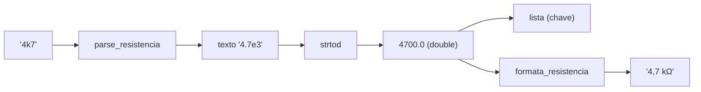

# 12 — Entrada de valores (resistências e quantidades)

← Anterior: [11 — Registro de ações](11-registro-de-acoes.md) · [Funcionalidades](README.md) · Próximo: [13 — Sair](13-sair.md)

**Onde:** em toda pergunta "Resistência:" e "Quantidade"
**Código:** `parse_resistencia`, `formata_resistencia` em [src/formatacao.c](../../src/formatacao.c); `ler_resistencia`, `ler_quantidade`, `parse_quantidade`, `parse_item` em [src/ui/telas.c](../../src/ui/telas.c); `ui_ler_linha`, `ui_confirmar` em [src/ui/ui.c](../../src/ui/ui.c)
**Módulo:** [Formatação](../modulos/formatacao.md)
**Testes:** [tests/test_formatacao.c](../../tests/test_formatacao.c), [tests/test_novo.c](../../tests/test_novo.c), e2e

---

## 1. Para que serve

Deixar a pessoa digitar valores **do jeito que estão escritos na bancada** e, ao mesmo tempo, garantir que o computador entenda sempre o mesmo número. Também padroniza como o programa **mostra** os valores.

## 2. Como digitar uma resistência

**Tabela 1 — Formatos aceitos**

| Você digita | Valor |
| --- | --- |
| `220`, `220R`, `220r`, `220 ohm`, `220 ohms`, `220 OHM`, `220Ω` | 220 Ω |
| `4700`, `4.7k`, `4,7k`, `4.7 k`, `4k7`, `4K7` | 4,7 kΩ |
| `1M`, `1M5`, `1.5M` | 1 MΩ, 1,5 MΩ |
| `470m`, `0.47`, `0,47`, `.47` | 470 mΩ |
| `4R7`, `2m2` | 4,7 Ω, 2,2 mΩ |

| Letra | Significa |
| --- | --- |
| `m` | mili (÷ 1000) |
| `R` / `r` | ohm (× 1), marca a vírgula: `4R7` = 4,7 |
| `k` / `K` | kilo (× 1000) |
| `M` | mega (× 1.000.000) |

**Recusados:** `4.7.1`, `4kk`, `4k7k`, `4 7`, `4x`, `-5`, `abc`, vazio, mais de 63 caracteres, menos de **1 mΩ** ou mais de **1000 MΩ**.

## 3. Como o programa mostra

Sempre na grandeza mais legível, com vírgula e até 3 casas, sem zeros sobrando: `470 mΩ`, `220 Ω`, `4,7 kΩ`, `4,75 kΩ`, `2,2 MΩ`. Um valor como 999,9996 Ω vira `1 kΩ` (e não "1000 Ω").

## 4. Quantidades e confirmações

| Pergunta | Aceita | Faixa |
| --- | --- | --- |
| Quantidade (Novo) | Inteiro | 0 a 2.147.483.647 |
| Quantidade a retirar / repor | Inteiro | 1 a 2.147.483.647 |
| Confirmação (s/n) | `s`, `S`, `n`, `N` (só a primeira letra conta: `sim` = `s`) | — |
| Ponto do checkpoint (sem terminal) | Inteiro | 0 a total |

## 5. Regras comuns a todas as perguntas

| Regra | Detalhe |
| --- | --- |
| **Enter vazio cancela** | Em qualquer pergunta (no lote do Novo, encerra a lista) |
| **3 tentativas** | Depois de 3 entradas inválidas, a operação é cancelada |
| Espaços nas pontas | Ignorados |
| Linha muito longa | O excesso é descartado |
| Fim da entrada (EOF) | Mesmo efeito de cancelar |
| Cada entrada inválida | Vira uma linha `ERRO` no log, com o texto digitado entre aspas |

## 6. Por dentro

**Figura 1 — Ida e volta de um valor**

O ponto-chave: o texto é convertido em notação científica e lido por **um único `strtod`**. Assim `470m` e `0.47` viram **exatamente** o mesmo `double`, e o mesmo resistor nunca é cadastrado duas vezes. Detalhes em [modulos/formatacao.md](../modulos/formatacao.md#32-o-truque-do-strtod-único).

Quantidades usam `strtoll` (64 bits) e só depois conferem se cabem num `int`, para recusar com segurança valores como `99999999999`.

## 7. Por que é assim

| Decisão | Motivo |
| --- | --- |
| Muitos formatos | É como os valores aparecem nos componentes e nos esquemas |
| `m` ≠ `M` | Convenção do Sistema Internacional |
| Chave canônica | Evita duplicados invisíveis por arredondamento binário |
| Cancelar com Enter vazio | Saída óbvia e igual em todo lugar |
| 3 tentativas | Tolera erro de digitação sem prender a pessoa |

## 8. Testes

- `test_formatacao.c`: todos os formatos, limites, chave canônica, inválidos, grandezas, arredondamento, ida e volta.
- `test_novo.c`: `parse_item` e limite de `int`.
- e2e: `abc`, `4.7.1`, `xyz` → três "Valor inválido" e "Operação cancelada".

---

← Anterior: [11 — Registro de ações](11-registro-de-acoes.md) · [Funcionalidades](README.md) · Próximo: [13 — Sair](13-sair.md)
