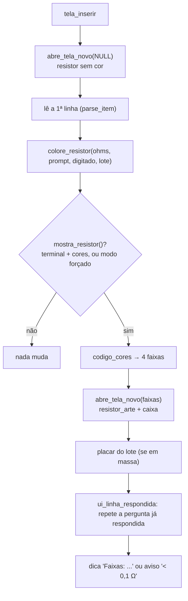

# 14 — Resistor colorido (código de cores na tela Novo)

← Anterior: [13 — Sair](13-sair.md) · [Funcionalidades](README.md)

**Onde:** tela `[1] Novo`, automático
**Código:** `mostra_resistor`, `abre_tela_novo`, `colore_resistor`, `telas_definir_resistor` em [src/ui/telas.c](../../src/ui/telas.c); [src/resistor.c](../../src/resistor.c); `ui_linha_respondida` em [src/ui/ui.c](../../src/ui/ui.c)
**Módulo:** [Resistor](../modulos/resistor.md)
**Testes:** [tests/test_resistor.c](../../tests/test_resistor.c), [tests/test_novo.c](../../tests/test_novo.c)

---

## 1. Para que serve

Ao cadastrar um valor, a tela Novo **desenha o resistor com as faixas de cor** correspondentes e escreve o nome de cada cor. Assim, quem está com o componente na mão confere na hora se o valor digitado bate com o resistor físico, e quem está aprendendo pratica a leitura do código de cores.

## 2. Como usar

Nada a configurar. Ao abrir `[1] Novo`, a caixa do título mostra um resistor **sem cor** (só contorno). Depois da primeira resistência válida, a tela é redesenhada:

```text
╭─ Novo resistor ──────────────────────╮
│   (resistor em pixel-art: corpo bege │
│    com faixas amarelo, violeta,      │
│    vermelho e dourado)               │
╰──────────────────────────────────────╯
  Formatos aceitos: 220 · 4k7 · 4.7k · 1M · 470m
  ...
» Resistência: 4k7
  Faixas: amarelo · violeta · vermelho · dourado
» Quantidade : 10
```

<!-- Print sugerido: docs/img/novo-resistor-colorido.png -->

No modo **em massa**, cada linha válida redesenha o resistor com as cores daquele item. Como o redesenho limpa a tela, aparece o placar do lote:

```text
  Lote até agora: 2 inseridos · 0 duplicados · 1 inválidos
» Resistência [quantidade]: 10 2
  Faixas: marrom · preto · preto · dourado
  ✔ 10 Ω inserido (2 un.)
```

## 3. Regras e casos especiais

| Situação | Comportamento |
| --- | --- |
| Valor com 3+ algarismos (ex.: 4,75 kΩ) | Cores do valor arredondado para 2 algarismos e o aviso **(aprox.)** |
| Valor menor que 0,1 Ω | ⚠ *"Abaixo de 0,1 Ω: sem código de 4 faixas"* |
| Entre 0,1 e 0,99 Ω | 3ª faixa **prata** (×0,01) ou **dourada** (×0,1) |
| Linha inválida no lote | Não redesenha; o erro aparece abaixo do desenho atual |
| Sem terminal (testes, e2e), sem cores (`NO_COLOR`) | Desenho desligado; a tela fica como antes |
| Compilado com `-DOHM_ASCII` | Desenho sempre desligado |

O desenho é **só visual**: não muda o cadastro, o log nem o desfazer.

## 4. Por dentro



**Figura 1 — Redesenho com o código de cores**

- `mostra_resistor()` usa o modo definido por `telas_definir_resistor`: **−1** automático (padrão: só no terminal com cores), **0** nunca, **1** sempre (usado nos testes, que não têm terminal).
- `ui_linha_respondida` reescreve `» Resistência: 4k7` depois de limpar a tela, para a pessoa não perder o que digitou.
- Algoritmo das faixas e técnica do desenho: [modulos/resistor.md](../modulos/resistor.md).

## 5. Por que é assim

| Decisão | Motivo |
| --- | --- |
| Mostrar na tela Novo | É o momento em que a pessoa está com o componente na mão |
| Desligado sem terminal/cores | O e2e e os testes de texto continuam iguais; terminais sem cor não recebem lixo |
| Placar do lote | O redesenho apaga as mensagens anteriores; o placar mantém o contexto |
| Modo forçável | Permite testar o desenho sem terminal real |

## 6. Testes

- `test_resistor.c`: 11 testes do código de cores e do desenho.
- `test_novo.c`: `teste_novo_em_massa_recolore_resistor` (4 redesenhos para 3 itens válidos + inicial, faixas de cada item, placar) e `teste_novo_sem_terminal_sem_resistor` (sem terminal não há desenho).
- Não verificado automaticamente: a aparência no terminal real (o teste força o desenho sem terminal).

---

← Anterior: [13 — Sair](13-sair.md) · [Funcionalidades](README.md)
