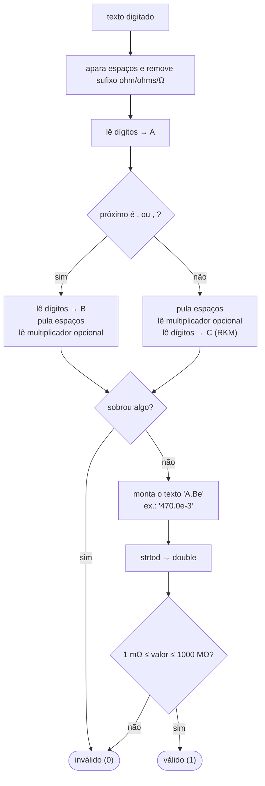

# Módulo Formatação — texto ↔ resistência

← Anterior: [Lista](lista.md) · [Módulos](README.md) · Próximo: [Resistor](resistor.md)

**Arquivos:** [src/formatacao.h](../../src/formatacao.h) · [src/formatacao.c](../../src/formatacao.c)
**Testes:** [tests/test_formatacao.c](../../tests/test_formatacao.c)

> **Resumo:** converte o que a pessoa digita (`4k7`, `0,47`, `1M5`...) em um número em ohms, e converte um número em ohms em texto legível na unidade certa (`4,7 kΩ`, `470 mΩ`).

---

## 1. Explicação para leigos

É o **tradutor** entre a linguagem da bancada e a do computador. O técnico diz "quatro-k-sete"; o computador precisa de `4700.0`. Na volta, o computador tem `0.47` e o técnico quer ler "470 miliohms". Este módulo faz as duas traduções e garante que **jeitos diferentes de escrever o mesmo valor virem exatamente o mesmo número**, senão o estoque teria o mesmo resistor cadastrado duas vezes.

## 2. Interface

| Item | Descrição |
| --- | --- |
| `int parse_resistencia(const char *s, double *ohms)` | 1 e grava em `*ohms` se `s` for válido e estiver na faixa da lista; 0 caso contrário |
| `int grandeza_resistencia(double ohms)` | `GRANDEZA_MILI`, `_UNIDADE`, `_KILO` ou `_MEGA`, já considerando o arredondamento |
| `void formata_resistencia(double ohms, char *buf, size_t n)` | Escreve em `buf` o texto, ex.: `"4,7 kΩ"` |
| `SIMBOLO_OHM` | `"Ω"` em UTF-8, ou `"ohm"` com `-DOHM_ASCII` |

## 3. Entrada: a gramática aceita

Antes de analisar, o parse **remove espaços nas pontas** e o **sufixo opcional** `ohm`, `ohms` (sem diferenciar maiúsculas) ou `Ω`. Depois aceita duas formas:

| Forma | Padrão | Exemplos |
| --- | --- | --- |
| **Decimal** | `A [(.|,) B] [espaços] [mult]` | `4700`, `4.7k`, `0,47`, `220R`, `4.7 k` |
| **RKM** (letra no lugar da vírgula) | `A mult C` | `4k7`, `1M5`, `4R7`, `2m2` |

Onde `A`, `B`, `C` são sequências de dígitos (A ou B não vazio) e `mult` é um multiplicador da Tabela 1.

**Tabela 1 — Multiplicadores**

| Letra | Nome | Expoente | Exemplo |
| --- | --- | --- | --- |
| `m` | mili | 10⁻³ | `470m` = 0,47 Ω |
| `R` ou `r` | unidade | 10⁰ | `4R7` = 4,7 Ω |
| `k` ou `K` | kilo | 10³ | `4k7` = 4700 Ω |
| `M` | mega | 10⁶ | `1M5` = 1.500.000 Ω |

`m` e `M` são diferentes de propósito: é a convenção do Sistema Internacional (mili × mega).

**Rejeitados** (devolvem 0): texto vazio, mais de 63 caracteres, sobra de caracteres (`4kk`, `4k7k`, `4 7`, `4.7.1`), letra desconhecida (`4x`), números negativos, e qualquer valor fora de **1 mΩ a 1000 MΩ** (a mesma faixa da [Lista](lista.md)).

### 3.1 O algoritmo

**Figura 1 — Etapas do `parse_resistencia`**

### 3.2 O truque do `strtod` único

A forma óbvia seria ler `470` e multiplicar por `0.001`. O problema: **0,001 não é exato em binário**, então `470 * 0.001` pode dar um `double` ligeiramente diferente de ler `0.47` direto. Dois cartões para o mesmo resistor!

A solução é **montar um texto em notação científica** e convertê-lo **uma única vez**:

| Digitado | Texto montado | `double` |
| --- | --- | --- |
| `470m` | `"470.0e-3"` | 0.47 |
| `0.47` | `"0.47e0"` | 0.47 (idêntico) |
| `4k7` | `"4.7e3"` | 4700 |
| `4700` | `"4700.0e0"` | 4700 (idêntico) |

O `strtod` da biblioteca C faz **arredondamento correto**: o mesmo número decimal sempre vira o mesmo `double`, não importa como foi escrito. O teste `teste_parse_chave_canonica` confere isso com `==` exato. A comparação com tolerância da lista continua como rede de segurança.

## 4. Saída: escolher a grandeza

`grandeza_resistencia` decide a unidade:

| Valor (Ω) | Grandeza | Divide por |
| --- | --- | --- |
| < 1 | mΩ | 0,001 |
| 1 a < 1.000 | Ω | 1 |
| 1.000 a < 1.000.000 | kΩ | 1.000 |
| ≥ 1.000.000 | MΩ | 1.000.000 |

**Caso de fronteira:** 999,9996 Ω arredondado para 3 casas vira 1000,000, e "1000 Ω" é feio. Por isso, se o valor arredondado chegar a 1000, a grandeza sobe um degrau e ele é impresso como **1 kΩ**.

`formata_resistencia` então:

1. Divide pela escala e arredonda para 3 casas (`floor(v * 1000 + 0.5) / 1000`).
2. Imprime com `%.3f` (ex.: `4.700`).
3. Remove zeros à direita e o ponto, se sobrar inteiro (`4.7`, `220`).
4. Troca o ponto por **vírgula** (padrão brasileiro): `4,7`.
5. Junta a unidade: `4,7 kΩ`.

**Tabela 2 — Exemplos de saída**

| Valor (Ω) | Texto |
| --- | --- |
| 0.47 | `470 mΩ` |
| 220 | `220 Ω` |
| 4700 | `4,7 kΩ` |
| 4750 | `4,75 kΩ` |
| 2200000 | `2,2 MΩ` |
| 999.9996 | `1 kΩ` |

## 5. Por que foi feito assim

| Decisão | Motivo |
| --- | --- |
| Aceitar vários formatos | É como os valores aparecem impressos nos resistores, nas caixas e em esquemas |
| RKM (`4k7`) | Notação padrão da indústria; evita perder a vírgula num papel sujo |
| Sufixo `ohm`/`Ω` opcional | Quem digita `220 ohm` não deve receber erro |
| `strtod` sobre texto montado | Mesma chave para todas as grafias ([seção 3.2](#32-o-truque-do-strtod-único)) |
| Vírgula decimal na saída | Programa em pt-BR |
| Até 3 casas, sem zeros sobrando | Legível e suficiente para a precisão de resistores comerciais |
| Faixa repetida da lista | O parse já recusa o valor, e a tela mostra uma mensagem melhor do que um erro genérico da lista |

## 6. Testes

[tests/test_formatacao.c](../../tests/test_formatacao.c), 12 testes: número puro, multiplicadores, RKM, espaços e sufixo, limites da faixa, chave canônica (grafias iguais → mesmo `double`), entradas inválidas, as quatro grandezas, casas decimais, fronteira de arredondamento, buffer pequeno e **ida e volta** (formatar e fazer parse de novo dá o mesmo valor).

---

← Anterior: [Lista](lista.md) · [Módulos](README.md) · Próximo: [Resistor](resistor.md)
