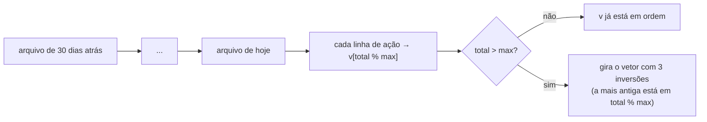

# Módulo Log — registro das ações em arquivo

← Anterior: [Checkpoint](checkpoint.md) · [Módulos](README.md) · Próximo: [UI](ui.md)

**Arquivos:** [src/log.h](../../src/log.h) · [src/log.c](../../src/log.c)
**Testes:** [tests/test_log.c](../../tests/test_log.c)
**Funcionalidades:** [Registro de ações](../funcionalidades/11-registro-de-acoes.md) · [Histórico](../funcionalidades/09-historico.md)

> **Resumo:** grava cada ação do programa como uma linha de texto em um arquivo por dia (`ohmflow_AAAA-MM-DD.log`) e lê essas linhas de volta para a tela de Histórico.

---

## 1. Explicação para leigos

É o **livro de ocorrências** do almoxarifado. Cada vez que alguém abre o programa, uma nova "página" (sessão) começa com data e hora. Cada coisa feita, inclusive erros e desistências, vira uma linha. Ao fechar, a página termina com quanto tempo a sessão durou. O livro fica num arquivo de texto comum, que qualquer um abre no Bloco de Notas.

## 2. Formato do arquivo

```text
================================================================
 OhmFlow — sessão iniciada em 27/10/2026 14:03:12
================================================================
27/10/2026 14:03:20 | INFO  | NOVO          | 4,7 kΩ     | qtd 50               | OK
27/10/2026 14:04:01 | AVISO | RETIRAR       | 4,7 kΩ     | -70 (tem 50)         | SEM ESTOQUE
27/10/2026 14:04:15 | ERRO  | NOVO          | "abc"      | -                    | VALOR INVÁLIDO
================================================================
 OhmFlow — sessão encerrada em 27/10/2026 14:06:10 (2m 58s)
================================================================
```

**Tabela 1 — Colunas de uma linha de ação**

| Coluna | Largura | Conteúdo |
| --- | --- | --- |
| Data e hora | 19 | `dd/mm/aaaa hh:mm:ss` |
| Nível | 5 | `INFO` (deu certo), `AVISO` (não deu, sem erro do usuário), `ERRO` (entrada inválida ou falha) |
| Ação | 13 | `NOVO`, `REMOVER`, `LISTAR`, `CONSULTAR`, `RETIRAR`, `REPOR`, `REINICIALIZAR`, `DIFERENCIAL`, `HISTÓRICO`, `MENU`, `DESFAZER`, `REFAZER`, `CHECKPOINT` |
| Alvo | 10 | Resistor formatado, ou o texto digitado entre aspas, ou `-` |
| Detalhe | 20 | Ex.: `qtd 50`, `-3 (10→7)`, `+10 (tem 5)` |
| Resultado | livre | `OK`, `SEM ESTOQUE`, `CANCELADO`, `NÃO ENCONTRADO`... |

As colunas são separadas por ` | ` e completadas com espaços (contando caracteres UTF-8 visíveis, não bytes), para alinhar no Bloco de Notas. Dentro de um campo, `|` vira `/` e quebras de linha viram espaço, para nunca desalinhar.

## 3. Onde fica a pasta

`resolve_pasta` escolhe, nesta ordem:

| Prioridade | Fonte | Uso |
| --- | --- | --- |
| 1 | `log_definir_pasta(...)` | Testes |
| 2 | Variável de ambiente `OHMFLOW_LOGS_DIR` | `make e2e`, uso avançado |
| 3 | `%APPDATA%\OhmFlow\logs` (só se compilado com `-DOHM_LOGS_APPDATA`) | Exe do instalador, porque a pasta de instalação pode não aceitar escrita |
| 4 | `logs` na pasta atual | Desenvolvimento (`make run`) |

`cria_pastas` cria as pastas intermediárias que faltarem (ex.: `OhmFlow\` e `logs\`).

## 4. Funções

**Tabela 2 — API do log**

| Função | Faz |
| --- | --- |
| `log_iniciar()` | Cria a pasta, abre o arquivo do dia em modo **acrescentar** e escreve o cabeçalho; 1 se ok |
| `log_acao(nivel, acao, alvo, detalhe, resultado)` | Formata e grava uma linha; `fflush` imediato |
| `log_encerrar()` | Escreve o rodapé com a duração (`Xm Ys` ou `Xh Ym Zs`) e fecha |
| `log_ativo()` | 1 se há sessão aberta |
| `log_formata_linha(...)` | Monta a linha num buffer (usada por `log_acao` e pelos testes) |
| `log_caminho_do_dia(buf, n)` | Caminho do arquivo de hoje |
| `log_parse_linha(linha, &e)` | Quebra uma linha de ação em 6 campos; 0 para cabeçalho, rodapé e linhas vazias |
| `log_ultimas(v, max)` | Lê os arquivos dos **últimos 30 dias** (`LOG_DIAS_HISTORICO`) e devolve as `max` ações mais recentes, em ordem cronológica |
| `log_definir_pasta`, `log_definir_relogio` | Ganchos para os testes forçarem a pasta e o relógio |

## 5. Leitura: o buffer circular de `log_ultimas`

A tela de Histórico quer só as 15 ações mais recentes, mas os arquivos podem ter milhares. Guardar tudo e depois cortar desperdiçaria memória. A solução é um **buffer circular**: um vetor fixo de `max` posições em que a linha número *k* vai para a posição `k % max`, sobrescrevendo a mais antiga.



**Figura 1 — Leitura das últimas ações**

A "rotação com três inversões" é um truque clássico: inverter `[0, ini)`, inverter `[ini, max)` e inverter tudo coloca o vetor na ordem certa sem memória extra.

## 6. "Best effort": o log nunca derruba o programa

Se a pasta não puder ser criada ou o arquivo não abrir, `log_iniciar` devolve 0, o `main` mostra **um** aviso e todas as outras funções viram **no-op** (não fazem nada). O controle de estoque continua funcionando normalmente. O log é útil, mas não é essencial.

## 7. Por que foi feito assim

| Decisão | Motivo |
| --- | --- |
| Texto puro, UTF-8 | Qualquer pessoa lê sem programa especial |
| Um arquivo por dia | Arquivos pequenos; fácil achar e apagar dias antigos |
| Modo acrescentar | Várias sessões no mesmo dia, sem apagar as anteriores |
| `fflush` a cada linha | A linha sobrevive se a janela for fechada no X ou o programa travar |
| Colunas de largura fixa | Legível no Bloco de Notas e fácil de quebrar de volta em campos |
| Registrar também erros e cancelamentos | Mostra o uso real, inclusive dificuldades com a entrada |
| Relógio injetável | Os testes simulam dias diferentes e durações longas sem esperar |
| Não usar o log para desfazer | O log guarda texto formatado (`4,7 kΩ`), não o `double` exato; o [Checkpoint](checkpoint.md) guarda os valores exatos |

## 8. Testes

[tests/test_log.c](../../tests/test_log.c), 16 testes: alinhamento das colunas, os três níveis, campos `NULL`, troca de `|` e quebras de linha, buffer pequeno; sessão cria pasta e cabeçalho, ação e rodapé, duração com horas, segunda sessão acrescenta, pasta inválida não quebra, chamadas sem iniciar não fazem nada; parse de linha de ação, ignorar o que não é ação, últimas ações em ordem, juntar dias diferentes e ausência de arquivos.

---

← Anterior: [Checkpoint](checkpoint.md) · [Módulos](README.md) · Próximo: [UI](ui.md)
