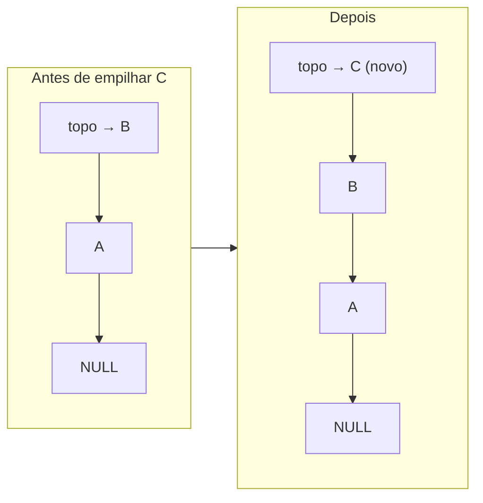

# Módulo Pilha — TAD Pilha Dinâmica de operações

← Anterior: [Resistor](resistor.md) · [Módulos](README.md) · Próximo: [Checkpoint](checkpoint.md)

**Arquivos:** [src/pilha.h](../../src/pilha.h) · [src/pilha.c](../../src/pilha.c)
**Testes:** [tests/test_pilha.c](../../tests/test_pilha.c)
**Funcionalidade que usa:** [Desfazer e refazer](../funcionalidades/10-desfazer-refazer.md)

> **Resumo:** pilha encadeada (LIFO) em que cada nó guarda uma `Operacao` feita no estoque, com tudo o que é preciso para desfazê-la e refazê-la. É a peça de base do [Checkpoint](checkpoint.md).

---

## 1. Explicação para leigos

Pense num **espeto de notas fiscais** em cima do balcão. Cada ação feita no estoque vira uma nota espetada **por cima** das outras. Para desfazer, você puxa a nota **de cima**, a mais recente. Não dá para puxar uma do meio sem tirar as de cima antes. Isso é uma pilha: o último a entrar é o primeiro a sair.

## 2. Estruturas

### 2.1 `Operacao` (pública)

```c
enum { OP_NOVO = 0, OP_REMOVER, OP_RETIRAR, OP_REPOR, OP_REINICIALIZAR };

typedef struct {
    int       tipo;        /* OP_*                                       */
    time_t    quando;      /* instante em que a ação foi feita           */
    double    resistencia; /* RETIRAR/REPOR: resistor movimentado (Ω)    */
    int       qtd;         /* RETIRAR/REPOR: unidades movimentadas       */
    Resistor *itens;       /* NOVO (1 ou lote), REMOVER (1),
                              REINICIALIZAR (foto do estoque); senão NULL */
    int       n_itens;
} Operacao;
```

A Tabela 1 mostra quais campos cada tipo usa. A ideia é guardar **o mínimo necessário para inverter a ação**.

**Tabela 1 — Campos usados por tipo de operação**

| Tipo | `resistencia`, `qtd` | `itens`, `n_itens` | Por quê |
| --- | --- | --- | --- |
| `OP_NOVO` | — | os resistores inseridos (1 ou o lote) | Desfazer = remover esses; refazer = reinseri-los com a mesma quantidade |
| `OP_REMOVER` | — | o resistor removido, com a quantidade que tinha | Reinserir exatamente como era |
| `OP_RETIRAR` | valor e unidades | — | Desfazer = repor as mesmas unidades |
| `OP_REPOR` | valor e unidades | — | Desfazer = retirar as mesmas unidades |
| `OP_REINICIALIZAR` | — | **foto** do estoque inteiro antes de apagar | Reconstruir tudo |

### 2.2 Nó e descritor (privados)

```c
struct elemento_pilha {
    Operacao               dados;
    struct elemento_pilha *prox; /* nó de baixo */
};

struct descritor_pilha {     /* exposto como "Pilha", opaco */
    ElemP *topo;    /* nó do topo, ou NULL se vazia */
    int    tamanho; /* quantidade de nós            */
};
```

Mesmo padrão da [Lista](lista.md): tipo opaco com descritor, para `tamanho_pilha` sair em O(1).

### 2.3 Códigos de retorno

| Código | Valor | Quando |
| --- | --- | --- |
| `PILHA_OK` | 1 | Sucesso |
| `PILHA_ERRO` | 0 | Pilha `NULL` ou falta de memória |
| `PILHA_VAZIA` | -1 | Nada para desempilhar / sem topo |

## 3. Funções

**Tabela 2 — API da pilha**

| Função | Faz | Custo |
| --- | --- | --- |
| `cria_pilha()` | Aloca uma pilha vazia | O(1) |
| `libera_pilha(p)` | Libera os nós, os `itens` de cada operação e o descritor | O(n) |
| `esvazia_pilha(p)` | Igual, mas a pilha continua usável | O(n) |
| `tamanho_pilha(p)`, `pilha_vazia(p)` | Leem o descritor | O(1) |
| `empilha(p, op)` | Põe `op` no topo | O(1) |
| `desempilha(p, &op)` | Tira o topo e copia em `op` | O(1) |
| `topo_pilha(p, &ptr)` | Aponta para o topo sem remover | O(1) |
| `percorre_pilha(p, f, ctx)` | Chama `f` do topo para a base | O(n) |
| `libera_operacao(&op)` | Libera `op.itens` e zera o campo | O(1) |

A Figura 1 mostra que empilhar mexe só no topo.



**Figura 1 — Empilhar: o novo nó aponta para o antigo topo e vira o topo**

## 4. Regra de posse da memória (o ponto mais delicado)

`Operacao.itens` é um vetor alocado com `malloc`. Para não haver vazamento nem `free` duplo, o módulo define **quem é o dono** desse vetor a cada momento:

| Momento | Dono de `itens` |
| --- | --- |
| Antes de `empilha` | Quem criou a operação |
| `empilha` com sucesso | **A pilha** |
| `empilha` **falhou** (sem memória) | A pilha mesmo assim: ela **libera** os itens antes de devolver `PILHA_ERRO` |
| Depois de `desempilha` | **Quem desempilhou** (precisa empilhar em outro lugar ou chamar `libera_operacao`) |
| `esvazia_pilha` / `libera_pilha` | A pilha libera tudo |

A regra "`empilha` sempre fica com os itens, mesmo se falhar" simplifica quem chama: depois de `empilha`, não há nada a limpar, dê certo ou não.

## 5. Por que foi feito assim

| Decisão | Motivo |
| --- | --- |
| Pilha encadeada (não vetor) | Mesmo modelo dinâmico da disciplina; cresce sem limite fixo e sem realocar |
| Guardar a operação, não o estoque a cada passo | Retirar 3 peças custa um registro pequeno, não uma cópia da lista |
| Foto só no Reinicializar | É a única ação que não dá para inverter sem saber tudo o que existia |
| Posse explícita dos itens | Evita vazamento e `free` duplo, difíceis de achar no Windows (sem AddressSanitizer) |
| `percorre_pilha` com callback | O [Checkpoint](checkpoint.md) acha a i-ésima operação sem conhecer os nós |

## 6. Testes

[tests/test_pilha.c](../../tests/test_pilha.c), 7 testes: pilha nova vazia, ordem LIFO, `topo_pilha` não remove, posse dos itens (inclusive quando `empilha` falha), `esvazia_pilha` libera tudo, `percorre_pilha` do topo para a base e chamadas com `NULL`.

---

← Anterior: [Resistor](resistor.md) · [Módulos](README.md) · Próximo: [Checkpoint](checkpoint.md)
